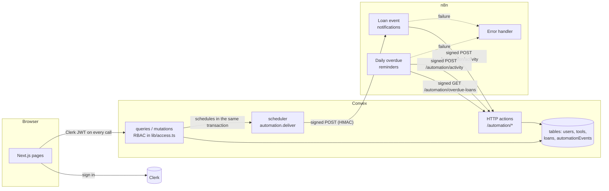

# LendLoop

**Borrow what you need. Lend what you don't.**

A small tool-lending library for a neighbourhood. Members list tools, ask to borrow them for a date range, and lenders approve, decline and mark loans returned. Two n8n workflows run alongside: one notifies people when a loan changes, and one sends a daily reminder for overdue loans.

| Layer | Choice |
|---|---|
| Frontend | Next.js 16 (App Router), Tailwind |
| Auth | Clerk |
| Data and backend logic | Convex (queries, mutations, HTTP actions, scheduler) |
| Automation | n8n 2.47 (self-hosted, Docker) |
| Tests | Vitest + `convex-test` |

---

## Run it locally

You need Node 20+, Docker, a Clerk account and (optionally) a Convex account.

### 1. Install

```bash
npm install
cp .env.example .env.local
```

### 2. Clerk

1. Create a Clerk application and turn on the **Convex integration** (Clerk dashboard → Integrations → Convex).
2. Put the publishable and secret keys in `.env.local`.
3. Copy the **Frontend API URL** (`https://<name>.clerk.accounts.dev`). You'll give it to Convex in step 3.
4. LendLoop reads `email` and `given_name` from the token. If your Clerk session token doesn't carry them, add them under **Sessions → Customize session token**:
   ```json
   { "email": "{{user.primary_email_address}}", "given_name": "{{user.first_name}}" }
   ```

### 3. Convex

```bash
npx convex dev
```

When it asks, pick a **local** deployment. Convex then runs on `127.0.0.1:3210` (API) and `:3211` (HTTP actions), which lets Convex and the n8n container reach each other with no tunnel. The CLI writes `CONVEX_DEPLOYMENT` and `NEXT_PUBLIC_CONVEX_URL` into `.env.local`. Leave it running. In a second terminal:

```bash
npx convex env set CLERK_JWT_ISSUER_DOMAIN https://<name>.clerk.accounts.dev
npx convex run seed:demo        # optional: demo tools plus one overdue loan
```

### 4. n8n

```bash
docker compose up -d
npm run setup:automation
```

`setup:automation` generates a random 256-bit HMAC secret and stores it in two places: the Convex deployment's environment and an encrypted n8n **Crypto** credential. It also sets `N8N_NOTIFY_WEBHOOK_URL` on Convex, imports the three workflows from `n8n/workflows/`, and publishes them. The secret is never printed or written into the repo. Run the script again to rotate the secret on both sides.

Open http://localhost:5678 and create the local n8n owner account to look at the workflows and their executions.

### 5. The app

```bash
npm run dev
```

Open http://localhost:3000 and sign in. To make yourself an admin (this can only be done from the CLI, never from the browser):

```bash
npx convex run users:setRole '{"email":"you@example.com","role":"admin"}'
```

### Try the automations

- **Notifications:** request a tool from a second account, then approve it. `docker compose logs -f n8n` shows the mock notification, and the loan shows "Notification sent just now".
- **Overdue reminders:** in n8n, open *LendLoop - Daily overdue reminders* and click **Execute workflow** (the manual trigger sits beside the 09:00 UTC schedule). With the seed data, Bilal gets a reminder about the drill. Run it again and nothing is sent.

### Tests

```bash
npm test          # 19 tests: RBAC, HMAC verify, idempotent write-backs
npm run lint
```

### Using a cloud Convex deployment instead

A cloud Convex deployment can't reach `localhost:5678`. Expose n8n with a tunnel (for example `cloudflared tunnel --url http://localhost:5678`), then run `N8N_NOTIFY_WEBHOOK_URL=https://<tunnel>/webhook/lendloop-loan-events npm run setup:automation`. Set `LENDLOOP_CONVEX_SITE_URL=https://<deployment>.convex.site` for the n8n container.

---

## Architecture



### Where things live

| Path | What it does |
|---|---|
| `convex/schema.ts` | Tables, indexes and the allowed values for category, condition and loan status |
| `convex/lib/access.ts` | `getViewer`, `requireUser`, `requireAdmin` and the pure ownership rules. Every authorisation decision goes through this file |
| `convex/lib/hmac.ts` | Signing and verification shared by both directions |
| `convex/users.ts` | `store` (creates the user row from the verified token), `me`, internal `setRole` |
| `convex/tools.ts` | Public list, member list with availability, and create, update and remove |
| `convex/loans.ts` | Request, approve, decline, mark returned, plus the three loan views |
| `convex/admin.ts` | List members, mark Trusted Lender |
| `convex/automation.ts` | Outbound webhook with retries, idempotent write-back, overdue query |
| `convex/http.ts` | The two signed HTTP endpoints n8n calls |
| `app/` | `/` is public. `/tools`, `/listings`, `/requests`, `/incoming` and `/admin` are for signed-in members |
| `n8n/workflows/` | Exported workflows, with no secrets in them |
| `scripts/setup-automation.mjs` | Creates the secret and wires Convex and n8n together |

### Loan lifecycle

A loan starts as a borrow request: `pending → approved → returned`, or `pending → declined`. `TRANSITIONS` in `convex/loans.ts` is the whole state machine. Each action allows exactly one `from` state, so a double-click or a retried mutation is rejected instead of applied twice. Approving checks for overlap with loans already approved on the same tool. Dates are stored as calendar dates (`YYYY-MM-DD`). "Today" is UTC.

### Notification flow (workflow 1)

1. A loan mutation changes status and calls `queueLoanNotification`. That builds a small payload and uses `ctx.scheduler.runAfter(0, internal.automation.deliver, …)`. The send is scheduled **inside the mutation's transaction**: if the mutation rolls back, nothing is sent, and if it commits, the send is guaranteed to be attempted. This works like an outbox pattern without needing a separate outbox table.
2. `deliver` signs the body and POSTs it to n8n. Network errors, 5xx, 408 and 429 are retried with backoff (30 s, 1 m, 2 m, 4 m). Other 4xx responses, such as a rejected signature, are not retried. If the last attempt fails, an `automationEvents` row records `webhook_delivery failed`, and the UI shows it on the loan.
3. n8n takes the **raw** body, recomputes the HMAC with the secret from its credential, compares in constant time, checks the timestamp is within 5 minutes, and only then parses the JSON. Bad requests get a `401`. Valid ones get a `202` straight away, so Convex's retries only cover "n8n didn't get it".
4. n8n sends the (mock) notification to the one person who needs it: the lender for a new request, the borrower for approved, declined or returned.
5. n8n signs a write-back, `{ key: "notification:<eventId>", loanId, kind, status }`, and POSTs it to Convex with node-level retries (3 tries, 3 s apart). If those run out, the error workflow fires.

### Overdue reminder flow (workflow 2)

1. Every day at 09:00 UTC (or on **Execute workflow**), n8n sends a signed `GET /automation/overdue-loans`.
2. Convex returns approved loans whose end date has passed, **minus those that already have a `sent` reminder for today**. The reminder key is `reminder:<loanId>:<YYYY-MM-DD>`.
3. For each loan, n8n sends the reminder (mock). If the borrower has no email on file, the status is `failed`. Either way it writes the status back under that key.

### Automation activity in the UI

Every write-back is a row in `automationEvents`. Each loan view shows the latest three, for example "Reminder sent 2 days ago" or "Webhook delivery failed 5 minutes ago". The page updates live because Convex queries are reactive.

---

## Security decisions

**RBAC is enforced in Convex, not the UI.** Every public query and mutation derives the caller from `ctx.auth.getUserIdentity()`, which comes from a Clerk JWT that Convex has already verified (issuer, audience `convex` and signature). No function accepts a user id as an argument. The rules:

| Action | Who |
|---|---|
| Create a listing | Any signed-in user. `ownerId` comes from the token, never from the client |
| Edit a listing | Its owner only. Admins can't edit other people's listings |
| Remove a listing | Its owner, or an admin |
| Request a loan | Any signed-in user, but not for their own tool |
| Approve, decline, mark returned | The tool's owner only. The borrower and admins get "Loan not found" |
| See a loan | Its borrower (My requests), its lender (Incoming), or an admin (All loans) |
| See all loans, list members, mark Trusted Lender | Admins only (`requireAdmin`) |
| Make someone an admin | Nobody in the app. Only `npx convex run users:setRole`, which needs the deployment's admin key |

The Next.js pages hide what you can't do, and the `(member)` layout redirects signed-out visitors. These checks are for convenience only. Calling the Convex functions directly gets the same answers. That is what `convex/rbac.test.ts` checks.

For loans that aren't yours, the error is "Loan not found" rather than "forbidden", so outsiders can't find out which loan ids exist. Tools are listed publicly anyway, so editing someone else's tool just says "You can only edit your own listings".

**HMAC signing, both directions.**

- Header `x-lendloop-timestamp: <unix seconds>` and header `x-lendloop-signature: sha256=<hex HMAC-SHA256(secret, "<timestamp>.<raw body>")>`. This is the same idea as Stripe's scheme.
- **Convex → n8n:** Convex signs (`lib/hmac.ts`). The n8n Crypto node recomputes the HMAC, and a Code node compares it in constant time and checks freshness.
- **n8n → Convex:** n8n signs both the overdue fetch and the write-backs. `convex/http.ts` verifies with `crypto.subtle.verify`, which is constant time, before reading the body.
- The signature covers the timestamp, so an old signature can't be moved to a fresh timestamp. Anything older than 5 minutes is rejected.
- Verification fails closed: a missing secret, a missing header or a malformed value all mean `401`.
- The body is parsed only **after** it has been verified, and the write-back body is then checked against an allowlist of `kind` and `status` values.

**Secrets.** The HMAC secret lives in exactly two places: a Convex environment variable and an n8n credential, which n8n encrypts at rest. The workflow JSON refers to the credential by id and name only. The n8n container's environment holds configuration (the Convex URL) and no secrets. That is why it's acceptable to set `N8N_BLOCK_ENV_ACCESS_IN_NODE=false` so workflows can read that URL. `.env*` files are git-ignored apart from `.env.example`. n8n is bound to `127.0.0.1`.

**Idempotency.**

| Retry | What stops a duplicate |
|---|---|
| A double-click or retried loan mutation | The state machine allows one `from` state per action |
| Convex resends a webhook | Each event has `eventId = <loanId>:<status>`, and every status is entered at most once, so n8n's write-back key repeats and Convex keeps one row |
| n8n retries a write-back | `recordActivity` looks up by `key` and then inserts or updates, inside one serialisable Convex transaction, so parallel retries can't create two rows. A repeat returns `200 duplicate`, so n8n treats it as success. `failed → sent` upgrades the row, and a late `failed` never downgrades `sent` |
| The daily job runs twice | The overdue endpoint leaves out loans with a `sent` reminder for today |

There is one remaining case: n8n sends a message and then can't reach Convex even after its retries. In that case the error workflow fires, and the next run could send that reminder again. Exactly-once delivery over a network isn't possible, so the design is at-least-once delivery plus idempotency keys at each hop. A real email or SMS provider would receive `eventId` or `reminderKey` as its idempotency key, which closes that last gap.

**Visible failures.** Both workflows name *LendLoop - Error handler* as their error workflow. It runs once a workflow's own retries are exhausted and logs an alert with the workflow, the failed node, the error message and a link to the execution. It deliberately leaves out the payload. On the Convex side, a delivery that gives up shows on the loan as "Webhook delivery failed".

## Data minimisation

| Who sees it | What they get | What they don't get |
|---|---|---|
| Public visitors | Tool name and category | Owner, description, condition, availability |
| Members | Tool details, the lender's **first name**, Trusted Lender badge, availability | Anyone's email, other people's loans |
| Each side of a loan | The other party's first name | Their email or anything else |
| Admins | Every member's name, email and role, and every loan | — |
| n8n, per loan event | `eventId`, type, status, tool name, dates, and the **one** recipient's first name and email | Tool description, the other party's details, internal user ids |
| n8n, overdue list | Loan id, reminder key, tool name, end date, days overdue, borrower's first name and email | Lender details |
| n8n logs | Emails masked (`b***@example.com`) | Full payloads in alerts |

Only a first name and an email are stored from the Clerk profile (`users.store`). Public queries declare `returns` validators, so a field added to a table later can't leak through a query without someone changing that query's contract. n8n's stored execution history (which holds payloads) is pruned after 7 days.

---

## What I'd change for production

- **Delivery provider.** Replace the mock Code nodes with a real email or SMS node, and pass `eventId` or `reminderKey` as the provider's idempotency key.
- **Secrets.** Use separate secrets for each direction, with a rotation overlap (accept the old and new secret for a short window). Keep n8n's `N8N_ENCRYPTION_KEY` in a secret manager, and run n8n with external task runners.
- **Replay protection.** Store recently seen signatures for the 5-minute window, so even an in-window replay is rejected rather than just being idempotent.
- **Durable outbox.** The Convex scheduler is durable, but an explicit outbox table would make pending and failed deliveries easy to query and replay from an admin screen.
- **Scale.** Paginate the lists that currently use `take(200)`, the overdue query (100 per run) and the availability lookups (one query per tool). Each is marked with a `Known limit:` comment.
- **Time zones.** Store a time zone per user, so "overdue" and reminder times follow local midnight instead of UTC.
- **Users.** Sync users from a Clerk webhook (`user.updated` and `user.deleted`), so name changes and account deletion reach Convex. Add data export and erasure for a member's loans.
- **Abuse limits.** Rate-limit borrow requests, cap open requests per user, and record an audit log of admin actions (removals, Trusted Lender changes).
- **Ops.** Add CI (lint, type check, tests, secret scanning), separate Convex and Clerk instances for each environment, alert on error-workflow runs, and run n8n on Postgres instead of SQLite.
